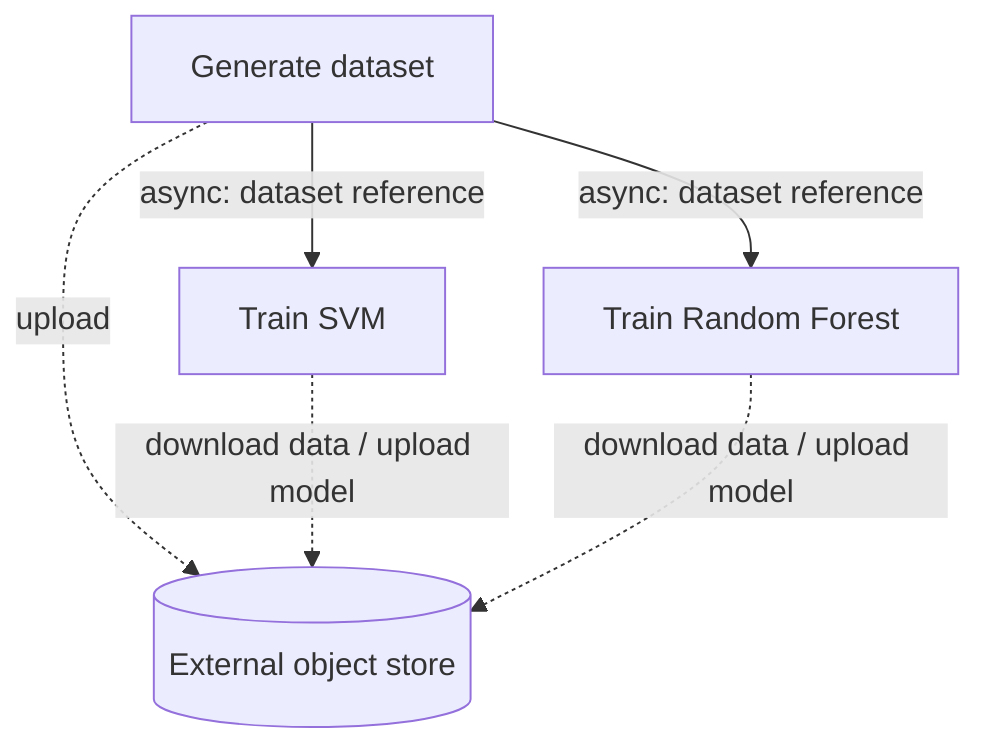
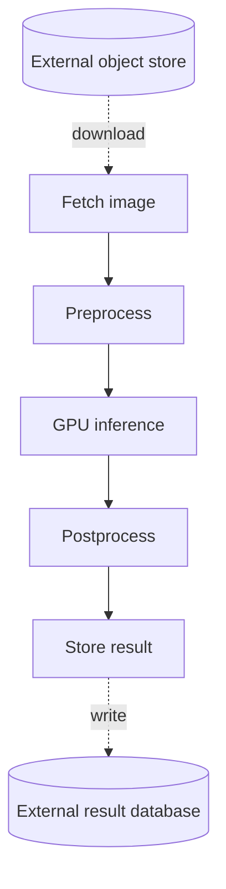

# Curated workflows

**All resource profiles are illustrative estimates, not measured production data.**
These examples are intended to help form merging hypotheses. They are not new
algorithms, runnable applications, or evidence of production performance.

Render the three saved graphs, their request-payload views, and a catalog with
per-stage profiles, sources, and assumptions, from the repository root:

```bash
python -m algorithm_testbench.catalog
```

Open `algorithm_testbench/outputs/workflow_catalog/index.md`. That output directory
is self-contained: it includes JSON snapshots and both SVG/PNG views of each graph.
The renderer works offline and does not fetch sources or change these examples.
Use `--output DIRECTORY`, `--workflow ml_training` (or `gpu_image_inference` or
`compose_post`), and `--orientation horizontal` to render a subset/different layout.
The existing single-graph visualizer also works on every JSON here.

## CPU-based parallel ML training



The function structure and 500-sample/1,024-feature input come from
[SeBS-Flow, Section V, Machine Learning](https://arxiv.org/html/2410.03480v1#S5).
The source uses an orchestrator and object storage; our adaptation makes the
generator launch two direct async function calls and await completion. It is not
an exact implementation of the original benchmark. No GPU is assigned.

The chosen data representation is 500 x 1,024 float64 features plus 500 int64
labels: **4,100,000 bytes**. The generator uploads it once and each trainer downloads
it once. Each call contains only a 512-byte reference/parameter envelope, not the
dataset. SVM and Random Forest upload illustrative 256 KiB and 1 MiB model artifacts.
There is no local scratch file. Host-memory estimates are 128, 256, and 384 MiB;
CPU proxies are 0.5, 1, and 2 active core equivalents. These values and artifact
sizes were not measured or reported as per-stage resource usage by SeBS-Flow.

Potential inspiration: small RPCs may be cheap to eliminate, while parallel
trainers have meaningful combined CPU/memory demand. Putting them in one process
does not by itself eliminate either dataset download or deduplicate a Python
runtime/model allocation. Passing a shared in-memory dataset would be a separate
application transformation, not a consequence we assume from merging.

## Warm GPU image inference



The preprocessing/inference/postprocessing pattern is documented by
[NVIDIA Triton's ensemble models](https://docs.nvidia.com/deeplearning/triton-inference-server/user-guide/docs/user_guide/ensemble_models.html).
Our five-function, locally GPU-backed serverless chain is an **illustrative
adaptation**, not a Triton benchmark or a claim about a cloud platform's GPU support.

The input budget is a 1 MiB encoded image representing 1,024 x 1,024 RGB pixels.
Preprocessing writes and reads that encoded image in its own temporary file,
then builds a 1 x 3 x 224 x 224 float32 tensor (**602,112 bytes**). Only this tensor
is passed to inference. Inference produces 1,000 float32 scores (**4,000 bytes**).
Postprocessing creates a 1 KiB result record. All four synchronous calls return
the same final 128-byte write acknowledgment, forwarded unchanged by each caller.

Only `infer_gpu` needs a GPU. Its illustrative warm resident weights occupy 1 GiB,
with **2 GiB total peak GPU memory** including working space. Host-memory estimates
are 64/128/512/64/64 MiB; CPU proxies are 0.05/0.8/0.15/0.1/0.02. They are chosen
profiles, not measured allocations or utilization. Cold model downloads, context
initialization, GPU compatibility constraints, and shared allocation accounting
are excluded. Peak host/device requirements are not automatically deduplicated.

Local scratch belongs only to preprocessing and is not confused with object-store
traffic. No temporary path crosses a function boundary. The fetch stage downloads
1 MiB externally; the store stage sends 1 KiB and receives 128 bytes externally.
All intermediate RPC traffic lives on edges, not in these external network fields.

Potential inspiration: colocating tensor-producing preprocessing with inference
could remove a substantial transfer, but puts CPU work into a GPU-requiring group.
Merging tiny postprocessing/database wrappers into that same group may have a
different tradeoff. The current Quilt model cannot evaluate GPU feasibility.

## Database-backed compose-post

This graph exactly reuses caller/callee pairs in
[the repository's synchronous funcTree](../../../benchmark/DeathStarBench/social_network/merge/funcTrees/funcTree.compose_post).
Its provenance also lists the function source files used to identify backend
calls. It has 11 functions, 10 edges, and no modeled GPU/local disk requirement.

The selected request contains one URL, two mentions, two media IDs, and twenty
followers. Mentions do not overlap followers, so home-timeline storage updates
**22** destinations. Both lookup caches miss, causing memcached then Redis access.
This is a fixed request case, not an asserted production cache-miss rate.

- `media-service` validates and repackages IDs/types; it does not fetch media blobs.
- `compose-creator-with-userid` formats an existing ID/name; it does not query a DB.
- `text-service` makes blocking mention and URL-shortening calls.
- `user-mention-service` and `social-graph-get-followers` access memcached/Redis.
- `store-post`, `write-user-timeline`, `write-home-timeline`, and
  `url-shorten-service` write remote Redis state.

These are the actual backends used by this repository's port, not an assumption
that the original upstream MongoDB deployment is used here. Remote Redis disk
activity is not local function disk I/O. A graph with sibling nodes does not imply
parallel execution: all compose-post edges here are synchronous, and the caller
issues them in program order.

CPU proxies range from 0.01 to 0.15 and host-memory estimates from 16 to 64 MiB.
Those are illustrative Rust helper/wrapper footprints, not measurements.
Payload and backend-transfer budgets are recorded in JSON. Each timeline update
uses a chosen 96-byte command allowance and 8-byte reply allowance, so home-timeline
traffic is 2,112 bytes sent / 176 received. The store-post profile budgets 2,304
bytes sent / 64 received for eight field writes. Other lookup/URL budgets likewise
describe selected payload/protocol allowances, not precise wire captures.

Potential inspiration: remote-store traffic survives merging, and large follower
fan-out can change that traffic without changing the function-call topology.
Alternative cache-hit/follower-count profiles would make useful future comparisons.

## Reading the data

Each edge is called once in each of 100 successful synthetic workflow executions,
giving `invocations = 100` and alpha one. Storage/network volumes are per function
invocation; byte payloads are per call. CPU is an average active-core proxy, not
CPU-seconds, an execution duration, or a guaranteed allocation. Memory is an
estimated host peak in MiB. No arrival rate or peak bandwidth is inferred.

Backend requests are described in node attributes and external-network fields,
not added as mergeable database nodes or double-counted as function-call payloads.
Ingress traffic, connection establishment, retries, failure paths, and transport
overhead are excluded except where explicitly budgeted. Warm runtime/model
assumptions are documented per example.

The profile values are deliberately fixed and role-dependent. They demonstrate
different shapes and possible resource tradeoffs; they must be calibrated against
measurements before supporting real-world performance claims. The existing Quilt
solver/evaluator still enforces CPU/memory only. Nothing here adds GPU or I/O
constraints, latency simulation, a new algorithm, or changes to old generators.
